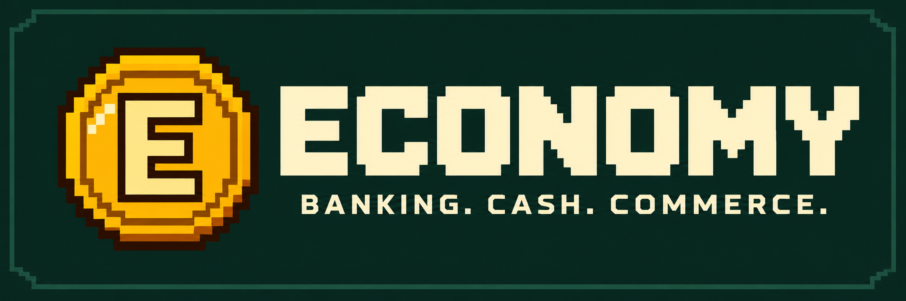

# Economy



Banking, physical cash and player shops for Minecraft, with credit, loans and a persistent world economy. Currently in alpha.

**Requires Minecraft 1.21.1 · NeoForge 21.1.252 · Java 21.** No additional mods are required.

## What's included

- Eleven currencies, daily exchange rates and collectible notes and coins.
- Accounts at 23 fictional banks, deposit interest and issued debit cards.
- ATMs, tellers, branch kiosks and registers with original artwork.
- Cash deposits and withdrawals, account transfers and player shops.
- Credit cards, fixed unsecured loans, credit reports and Collection Agents.
- Optional automatic payments, transaction history and recovery of interrupted payments and item deliveries.

New kiosks are two blocks wide and two blocks high. Existing narrow kiosks remain usable and offer a free **Upgrade kiosk** action in owner/operator settings when space and support are clear.

New eligible vanilla villages can generate mid-century modern bank branches, with compact and larger designs for all 23 banks across five village styles. Buildings use local wood and working branch kiosks. Existing villages are preserved; difficult terrain can leave a branch pending. Bankers and their job stations are still upcoming. See [branch diagnostics and terrain retry](docs/SERVER_GUIDE.md#village-branch-diagnostics).

Operators can find bank locations with `/locate structure #economy:banks`.

Securities trading, variable-rate loans and collateral-backed loans are future work. The Stock Trading Computer is currently decorative.

## Get started

1. Install the Economy jar in your NeoForge instance's `mods` folder.
2. Start a world and choose its currency when prompted; `/economy choose CAD` also supports selection.
3. Use a branch kiosk to open an account. Machine owners bind terminals to a bank through **sneak + empty-hand right-click** and enable cash services separately.
4. Use an ATM or teller to deposit, withdraw or exchange funds. An active issued card provides remote banking access.

Accounts are limited to four per player, with one per currency. Creative cards are collectibles and do not grant banking access. Financial time continues while the server is offline: one financial day lasts 20 real minutes, and a month lasts 28 financial days.

## Creative Collection Agents

Use `/summon economy:collection_agent ~ ~ ~` to place a Collection Agent, or find the **Collection Agent Spawn Egg** in the Economy and Spawn Eggs creative tabs. Operators can also use `/give @s economy:collection_agent_spawn_egg`.

Placed agents stay where you put them and persist with the world. Right-click within six blocks to review and pay your own eligible collection cases. Each player sees only their own debts. Placing an agent creates no debt and does not change the cooldown of automatic agents.

## Guides

- [Player guide](docs/PLAYER_GUIDE.md): accounts, terminals, cash, shops, credit, loans and automatic payments.
- [Server guide](docs/SERVER_GUIDE.md): configuration, diagnostics, upgrades, backups and restore.
- [Changelog](CHANGELOG.md): completed features and notable fixes.
- [Roadmap](ROADMAP.md): planned features and future direction.

**Upgrading an existing world?** Stop Minecraft and [prepare a complete-world upgrade backup](docs/SERVER_GUIDE.md#schema-upgrades) before opening it with a newer economy schema. Keep world and economy data together.

## Build and run

With Java 21 selected:

```sh
./gradlew build -x test
./gradlew runClient
./gradlew runServer
```

The jar is written to `build/libs/economy-0.2.0-alpha.jar`. Development client and server data are separate in `run/client` and `run/server`; use disposable development worlds.
